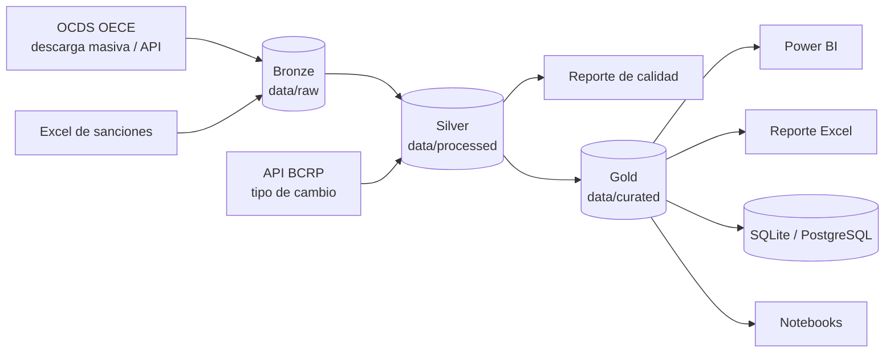

# Contrataciones Públicas del Perú: pipeline de analítica de datos


Pipeline en **Python** que convierte los datos abiertos de contrataciones públicas del Perú
(OECE/SEACE, estándar **OCDS**) en un modelo analítico confiable: ingesta desde archivos, APIs y
Excel; limpieza y control de calidad; modelo estrella; **indicadores de riesgo** (*red flags*);
y entrega en **Power BI**, **Excel** y bases de datos **SQLite / PostgreSQL** (local o en la nube).

## Qué responde

* ¿Cuánto se adjudica, cuándo y en qué (bienes, servicios, obras)?
* ¿Qué entidades concentran el gasto y en qué departamentos?
* ¿Qué proveedores reciben más contratos y en cuántas entidades?
* ¿Qué tan competidos son los procesos (postores, postor único, plazos)?
* ¿Qué procesos muestran señales de riesgo y conviene revisar primero?
* ¿Qué procesos se adjudicaron muy por encima o muy por debajo de lo esperado según su perfil?
  (Fase 2, machine learning)

## Arquitectura



Datos organizados con **arquitectura medallion** (bronze → silver → gold) y código organizado
**por capas** (`ingestion` → `processing` → `export`). Detalle en
[docs/02_arquitectura.md](docs/02_arquitectura.md).

## Inicio rápido

Requisitos: Python 3.11 o superior.

**Windows (PowerShell)**

```powershell
py -3.12 -m venv .venv
.\.venv\Scripts\Activate.ps1
pip install -e ".[dev]"
Copy-Item .env.example .env
contrataciones run --source sample
```

**Linux / macOS**

```bash
python3 -m venv .venv && source .venv/bin/activate
pip install -e ".[dev]"
cp .env.example .env
contrataciones run --source sample
```

En pocos segundos obtienes, a partir de datos **sintéticos** de demostración:

| Salida | Ubicación |
| --- | --- |
| Modelo estrella (13 tablas) para Power BI | `data/curated/*.parquet` |
| Mismas tablas en CSV | `data/exports/powerbi/*.csv` |
| Reporte ejecutivo en Excel | `data/exports/reporte_contrataciones.xlsx` |
| Base de datos con tablas y vistas | `data/db/contrataciones.db` |
| Reporte de calidad de datos | `data/processed/reporte_calidad.csv` |

### Con datos reales

```bash
contrataciones download --year 2025                        # ~150 MB comprimido
contrataciones run --source bulk --year 2025 --limit 20000  # primera prueba
contrataciones run --source bulk --year 2025                # año completo
contrataciones check-api                                    # API del OECE (por mes)
contrataciones run --source api --month 2025-09 --api-max-pages 5
```

El pipeline está adaptado a la forma real de la publicación del OECE (entidades con código
`PE-CONSUCODE` y RUC adicional, plazos con inicio = fin, estados vacíos, consorcios sin RUC):
ver [Particularidades de la publicación real](docs/04_fuentes_de_datos.md#particularidades-de-la-publicación-real).

Para el cruce de sanciones, copia el Excel/CSV de proveedores sancionados en `data/raw/excel/`
(ver [docs/04_fuentes_de_datos.md](docs/04_fuentes_de_datos.md)).

## Fase 2: modelo de monto esperado (machine learning)

Un modelo de regresión estima cuánto debería costar razonablemente cada proceso según lo que se
conoce **al convocarlo** (valor referencial, procedimiento, categoría, entidad, mes y plazo de
consultas) y marca los montos adjudicados atípicos: sobrecosto o subcosto inusual. No es un
detector de fraude.

```bash
pip install -e ".[dev,ml]"
contrataciones-ml train      # entrena, evalúa contra una línea base y registra el modelo
contrataciones-ml predict    # data/predictions, base de datos y reporte_montos_atipicos.xlsx
```

Lo central es evitar la **fuga de datos**: una guardia en el código rechaza toda columna que
solo se conoce después de adjudicar (postores, montos, alertas, proveedores...), la evaluación
es temporal y cada proceso del histórico se puntúa con un modelo que no lo vio. Con los datos
sintéticos el modelo **no** supera a la línea base, que es lo esperado: allí la razón
adjudicado/referencial es aleatoria. Detalle en
[docs/11_machine_learning.md](docs/11_machine_learning.md).

## Comandos

| Comando | Descripción |
| --- | --- |
| `contrataciones run --source sample\|bulk\|api` | Ejecuta el pipeline completo |
| `contrataciones download --year 2023-2025` | Descarga los archivos OCDS anuales |
| `contrataciones setup-db [--drop]` | Crea tablas, índices y vistas |
| `contrataciones query <archivo.sql> [--param k=v] [--output x.xlsx]` | Ejecuta una consulta SQL |
| `contrataciones check-api [--month AAAA-MM]` | Diagnostica las APIs del OECE y del BCRP |
| `contrataciones sample` | Regenera los datos sintéticos |
| `contrataciones-ml train` | Entrena y registra el modelo de monto esperado (Fase 2) |
| `contrataciones-ml predict [--version V] [--no-db]` | Monto esperado y montos atípicos |
| `contrataciones-ml list` | Lista los modelos registrados |
| `pytest` | Ejecuta las pruebas |

Opciones completas: [docs/05_pipeline_etl.md](docs/05_pipeline_etl.md).

## Estructura del proyecto

```
contrataciones-publicas-peru/
├── config/              Configuración YAML (rutas, BD, APIs, fuentes, reglas de riesgo)
├── data/
│   ├── raw/             Bronze: datos originales (OCDS, API, Excel)
│   ├── processed/       Silver: datos limpios + reporte de calidad
│   ├── curated/         Gold: modelo estrella para Power BI
│   ├── exports/         Reporte Excel y CSV
│   ├── external/        Datos de referencia (tipo de cambio)
│   ├── features/        [ML] Dataset de modelado
│   ├── predictions/     [ML] Monto esperado y montos atípicos
│   └── sample/          Datos sintéticos de demostración
├── docs/                Documentación completa
├── models/              [ML] Modelos entrenados, catálogo y bitácora de experimentos
├── notebooks/
│   ├── analytics/       Exploración, calidad, gasto e indicadores de riesgo
│   └── ml/              Auditoría de fuga de datos, objetivo, modelos y montos atípicos
├── powerbi/             Guía, medidas DAX, Power Query, tema y especificación del dashboard
├── scripts/             Atajos: run_pipeline.py, download_bulk.py, setup_db.py, refresh_data.py
├── sql/                 DDL, vistas y consultas (SQLite y PostgreSQL); *_ml para la Fase 2
├── src/contrataciones/
│   ├── ingestion/       API, OCDS, BCRP, Excel, base de datos
│   ├── processing/      Aplanado, limpieza, calidad, moneda, modelo gold, riesgo
│   ├── export/          Parquet/CSV, Excel, carga a BD
│   ├── utils/           Configuración, logging, constantes
│   ├── features/        [ML] Dataset, features y guardia contra la fuga de datos
│   ├── models/          [ML] Entrenamiento, evaluación, atípicos, registro y `contrataciones-ml`
│   ├── pipeline.py      Orquestación
│   └── cli.py           Comando `contrataciones`
├── tests/               Pruebas unitarias y de punta a punta
├── docker-compose.yml   PostgreSQL local
└── pyproject.toml       Paquete y dependencias
```

## Stack tecnológico

| Área | Herramientas |
| --- | --- |
| Lenguaje | Python 3.11+ |
| Procesamiento | pandas, PyArrow (Parquet) |
| Ingesta | requests (reintentos, paginación), openpyxl |
| Bases de datos | SQLAlchemy 2, SQLite, PostgreSQL (psycopg2, `COPY`) |
| Nube (opcional) | Supabase / Neon / Google Cloud SQL, BigQuery |
| Machine learning | scikit-learn (Ridge, HistGradientBoosting, TargetEncoder), joblib |
| Visualización | Power BI (DAX, Power Query), matplotlib, Excel |
| Calidad de software | pytest, ruff, GitHub Actions |

## Documentación

| | |
| --- | --- |
| [Contexto y objetivos](docs/01_contexto_y_objetivos.md) | [Modelo de datos](docs/06_modelo_de_datos.md) |
| [Arquitectura](docs/02_arquitectura.md) | [Calidad de datos](docs/07_calidad_de_datos.md) |
| [Instalación y configuración](docs/03_instalacion_y_configuracion.md) | [Indicadores de riesgo](docs/08_indicadores_de_riesgo.md) |
| [Fuentes de datos](docs/04_fuentes_de_datos.md) | [Base de datos](docs/09_base_de_datos.md) |
| [Pipeline ETL](docs/05_pipeline_etl.md) | [Convenciones y contribución](docs/10_convenciones_y_contribucion.md) |
| [Power BI](powerbi/README.md) | [Glosario](docs/glosario.md) · [Hoja de ruta](docs/roadmap.md) |

## Uso responsable

* Las **alertas de riesgo son señales para priorizar la revisión**, no pruebas de irregularidades
  ni atribución de responsabilidades. Verifica cada caso en la fuente oficial.
* Los datos de `data/sample` son **sintéticos** (entidades y proveedores "DEMO"). No representan
  la realidad.

## Licencia y atribución

* Código: [MIT](LICENSE).
* Datos: OECE (ex OSCE), Portal de Contrataciones Abiertas, estándar OCDS, redistribuidos por el
  Registro de Datos de Open Contracting Partnership bajo licencia
  [CC BY 4.0](https://creativecommons.org/licenses/by/4.0/). Tipo de cambio: BCRPData.

## Autor

**Kevin Edu Lopez Montalvo** · Proyecto de portafolio de analítica de datos.
