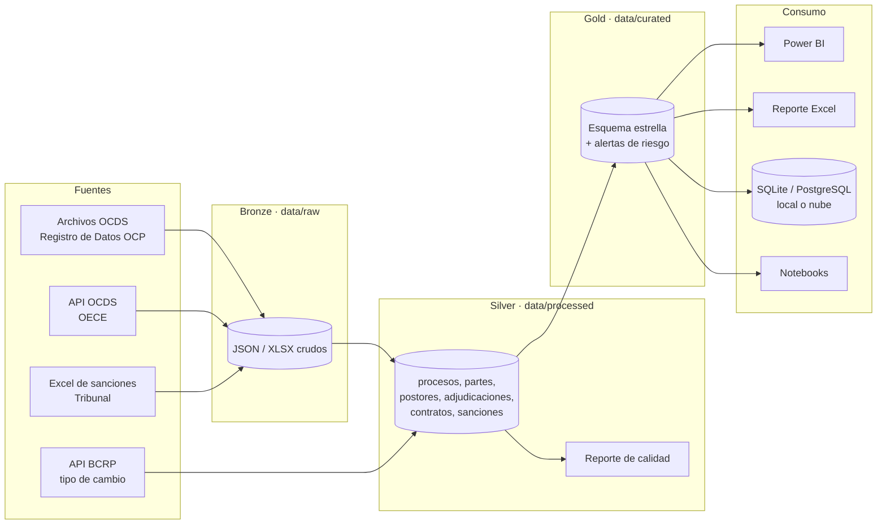

# 2. Arquitectura

El proyecto combina dos estándares de la industria:

* **Arquitectura medallion** para los **datos** (bronze → silver → gold), popularizada por
  Databricks y usada en equipos de datos para separar datos crudos, limpios y listos para
  consumo.
* **Arquitectura por capas** para el **código** (ingesta → procesamiento → exportación), el
  equivalente en analítica a la arquitectura por capas o *clean architecture* del backend.

## Vista general



## Capas de datos (medallion)

| Capa | Carpeta | Contenido | Formato | ¿Se modifica a mano? |
| --- | --- | --- | --- | --- |
| Bronze | `data/raw/` | Datos tal como llegan: `.jsonl.gz` OCDS, páginas JSON de la API, Excel de sanciones | Original | Nunca |
| Staging | `data/processed/_staging/` | JSON aplanado en 5 tablas, sin limpiar | Parquet | No (se regenera) |
| Silver | `data/processed/` | Datos limpios, tipados y deduplicados + reporte de calidad | Parquet / CSV | No (se regenera) |
| Gold | `data/curated/` | Modelo dimensional y alertas, listo para consumo | Parquet | No (se regenera) |
| Entrega | `data/exports/` | Reporte Excel y CSV para Power BI | XLSX / CSV | No (se regenera) |

Regla de oro: **los datos solo fluyen hacia la derecha**. Ninguna capa modifica una capa
anterior, de modo que cualquier resultado se puede reproducir desde bronze.

## Capas de código

```
src/contrataciones/
├── utils/        Transversal: configuración, logging, constantes, helpers
├── ingestion/    Leer fuentes (no transforma)
├── processing/   Transformar (no lee ni escribe archivos externos)
├── export/       Escribir salidas (no transforma)
├── pipeline.py   Orquesta las capas en el orden correcto
├── cli.py        Interfaz de línea de comandos
└── sample_data.py Generador de datos sintéticos
```

**Regla de dependencias** (como en *clean architecture*): cada capa solo conoce a las capas
"de abajo".

```
cli  ──>  pipeline  ──>  ingestion · processing · export  ──>  utils
```

* `processing` no sabe si los datos vinieron de un archivo o de una API: recibe DataFrames.
* `export` no sabe cómo se calcularon los datos: recibe DataFrames y los escribe.
* Cambiar de SQLite a PostgreSQL, o de archivo a API, no obliga a tocar la lógica de negocio.

La Fase 2 (machine learning) es una capa aparte que **lee la capa gold** y no modifica el
pipeline:

```
models.cli  ──>  models.workflow  ──>  features · models  ──>  export · utils
```

### Módulos y responsabilidades

| Capa | Módulo | Responsabilidad |
| --- | --- | --- |
| ingestion | `api_client.py` | Cliente HTTP genérico: reintentos, pausas, paginación, descargas |
| ingestion | `ocds_source.py` | Leer OCDS de archivos, de la API y descargar los archivos anuales |
| ingestion | `bcrp_client.py` | Tipo de cambio desde la API del BCRP, con caché local |
| ingestion | `excel_loader.py` | Excel/CSV con detección de encabezados y mapeo de columnas por alias |
| ingestion | `file_detector.py` | Detectar el formato de un archivo y cargarlo |
| ingestion | `db_connector.py` | Conexión a SQLite / PostgreSQL con SQLAlchemy |
| processing | `ocds_flattener.py` | JSON OCDS → 5 tablas planas, escritas por bloques |
| processing | `cleaner.py` | Limpieza genérica y de dominio (RUC, fechas, textos) |
| processing | `currency.py` | Conversión de montos a soles |
| processing | `validator.py` | Reglas de calidad y perfilado |
| processing | `risk_indicators.py` | Indicadores de riesgo y puntaje |
| processing | `transformer.py` | Modelo estrella (dimensiones, hechos, agregados) |
| export | `csv_exporter.py` | Parquet y CSV |
| export | `excel_exporter.py` | Reporte ejecutivo en Excel |
| export | `db_writer.py` | DDL, carga (full refresh / append / upsert) y vistas |
| features | `catalog.py` | Definición de las features y guardia contra la fuga de datos |
| features | `dataset.py` | Dataset de modelado: una fila por proceso, objetivo y población |
| features | `builder.py` | Transformaciones sin estado (logaritmo, mes, tipo de entidad) |
| features | `audit.py` | Auditoría de disponibilidad de los datos (Fase 0) |
| models | `trainer.py` | División temporal, línea base, candidatos, predicción fuera de muestra |
| models | `evaluator.py` | Métricas, mejora frente a la línea base, segmentos, importancia |
| models | `anomaly.py` | Escala robusta y clasificación de las desviaciones |
| models | `registry.py` | Guardado, carga, catálogo y bitácora de modelos |
| models | `predictor.py` | Puntaje de los procesos y exportación (archivos y base de datos) |
| models | `report.py` | Reporte Excel de montos atípicos |
| models | `workflow.py`, `cli.py` | Orquestación y comando `contrataciones-ml` |

## Estructura completa del repositorio

```
contrataciones-publicas-peru/
├── config/                 Configuración YAML (sin secretos)
│   ├── settings.yaml       Rutas, parámetros del pipeline, logging
│   ├── db_config.yaml      Perfiles de base de datos (SQLite, PostgreSQL local/nube)
│   ├── api_config.yaml     APIs: OECE, Registro de Datos OCP, BCRP
│   ├── sources.yaml        Contratos de datos: dónde están los archivos y alias de columnas
│   ├── risk_rules.yaml     Umbrales y pesos de los indicadores de riesgo
│   ├── export_config.yaml  Formato de CSV, Parquet y Excel
│   └── model_config.yaml   [ML] Población, features, división, modelos y atípicos
├── data/                   Datos por capa (ver data/README.md), incluidos features/ y predictions/
├── docs/                   Esta documentación
├── models/                 [ML] Modelos entrenados, catálogo y bitácora (generados)
├── notebooks/              analytics/ (análisis) y ml/ (modelo de monto esperado)
├── powerbi/                Guía, medidas DAX, Power Query, tema y especificación del dashboard
├── scripts/                Atajos ejecutables (run_pipeline.py, setup_db.py, ...)
├── sql/
│   ├── ddl/                Creación de tablas e índices (portable SQLite/PostgreSQL)
│   ├── views/              Vistas para análisis
│   ├── queries/            Consultas de negocio parametrizadas
│   └── ddl_ml/, views_ml/, queries_ml/   [ML] Tabla de predicciones, vista y consulta
├── src/contrataciones/     Código fuente (paquete instalable)
├── tests/                  Pruebas automatizadas (pytest)
├── .github/workflows/      Integración continua
├── docker-compose.yml      PostgreSQL local
├── pyproject.toml          Paquete, dependencias y configuración de herramientas
└── Makefile                Atajos de desarrollo
```

## Decisiones de diseño

Registro breve de decisiones (formato *ADR*: contexto → decisión → consecuencia).

| # | Decisión | Motivo | Consecuencia |
| --- | --- | --- | --- |
| D1 | Descarga masiva (OCP) como fuente principal y API como secundaria | La descarga anual es estable y completa; la API se consulta por mes, pagina de 20 en 20 y puede bloquear clientes automatizados | El pipeline funciona aunque la API falle; la API se usa para lo más reciente |
| D2 | Parquet como formato entre capas | Columnar, comprimido, conserva tipos y lo leen Power BI, pandas, BigQuery y Spark | Archivos más pequeños y sin errores de tipos al cambiar de herramienta |
| D3 | Aplanado por bloques (`chunk_size`) | Un año de datos pesa cientos de MB descomprimido | La memoria usada no depende del tamaño del archivo de entrada |
| D4 | Esquema estrella en la capa gold | Es el modelo recomendado para Power BI (medidas simples y rápidas) | Hechos y dimensiones con llaves enteras; detalle por tabla de hechos |
| D5 | SQL portable (SQLite + PostgreSQL) | Empezar sin instalar nada y pasar a la nube sin reescribir | Se evitan funciones propias de un motor; probado en ambos en las pruebas automatizadas |
| D6 | Carga *full refresh* en una transacción | Simple, idempotente y sin estados intermedios | Si algo falla, la base queda como estaba |
| D7 | Indicadores de riesgo basados en reglas | Transparentes, explicables y auditables; base para el ML posterior | Se calibran con `risk_rules.yaml` sin tocar código |
| D8 | Configuración en YAML + secretos en `.env` | Separar parámetros, credenciales y código | El mismo código corre en local, CI y nube |
| D9 | Paquete instalable (`src/` layout) + CLI | Estándar de empaquetado de Python (PyPA) | Imports limpios, pruebas fiables y comando `contrataciones` |
| D10 | Datos sintéticos versionados | Poder probar todo sin descargar 150 MB ni depender de internet | Pruebas y CI reproducibles |
| D11 | Machine learning fuera del pipeline: lee la capa gold | No duplicar lógica ni acoplar el pipeline a un modelo que se reentrena | `contrataciones-ml` corre después de `contrataciones run`; el pipeline no cambia |
| D12 | Guardia anti-fuga en el código, no en el YAML | La fuga de datos es el error más común y más caro de un modelo | Las features se declaran en YAML, pero las columnas del resultado se rechazan siempre |
| D13 | División temporal y predicción fuera de muestra | Simular "predecir procesos nuevos con lo aprendido de los pasados" y no puntuar con un modelo que vio el dato | Métricas honestas y atípicos comparables en todo el histórico |
| D14 | Montos atípicos como reporte aparte, no como RF08 | El puntaje de riesgo es determinista y RF03/RF04 ya cubren parte del sobrecosto | Se integrará como RF08 solo tras validarlo con datos reales |

## Dónde encaja machine learning (fase 2)

La capa gold está pensada para alimentar modelos. La fase 2 agregará `src/contrataciones/features`
y `src/contrataciones/models`, y las carpetas `data/features`, `data/predictions` y `models/`, sin
cambiar las capas existentes. Detalle en la [hoja de ruta](roadmap.md).
