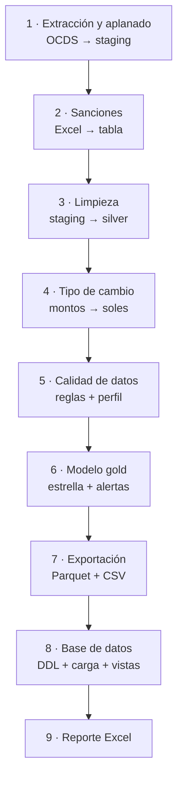

# 5. Pipeline ETL

El pipeline se ejecuta con un solo comando y recorre nueve pasos. Cada paso registra su duración
en el log (`logs/pipeline.log`) y en el manifiesto de la ejecución
(`data/curated/_manifest.json`).



## Cómo ejecutarlo

```bash
# Datos de demostración (sin internet)
contrataciones run --source sample

# Datos reales: descargar un año y procesarlo
contrataciones download --year 2025
contrataciones run --source bulk --year 2025

# Primera prueba con datos reales: solo 20 000 procesos y sin base de datos
contrataciones run --source bulk --year 2025 --limit 20000 --no-db

# Lo más reciente desde la API del OECE (consulta por mes de convocatoria)
contrataciones check-api
contrataciones run --source api --month 2025-09 --api-max-pages 10
contrataciones run --source api            # mes actual y anterior
```

Equivalente sin el comando instalado: `python scripts/run_pipeline.py --source sample`.

### Opciones de `contrataciones run`

| Opción | Descripción | Ejemplo |
| --- | --- | --- |
| `--source` | `sample` (sintético), `bulk` (archivos descargados) o `api` | `--source bulk` |
| `--input` | Archivo OCDS específico (repetible) | `--input data/raw/ocds/oece_2025.jsonl.gz` |
| `--year` | Filtra por año de convocatoria (con `api`: consulta sus 12 meses) | `--year 2025` |
| `--date-from`, `--date-to` | Rango de fechas de convocatoria (AAAA-MM-DD); con `api` define los meses | `--date-from 2025-01-01` |
| `--month` | Mes a consultar en la API, repetible (`--source api`) | `--month 2025-09` |
| `--limit` | Máximo de procesos a procesar | `--limit 50000` |
| `--sanctions` | Archivo de sanciones (si no, se busca en `data/raw/excel`) | `--sanctions sanciones.xlsx` |
| `--rates` | Fuente del tipo de cambio: `bcrp`, `file` o `none` | `--rates none` |
| `--rates-file` | CSV de tipo de cambio para `--rates file` | `--rates-file tc.csv` |
| `--api-max-pages` | Máximo de páginas por mes en la API (`--source api`) | `--api-max-pages 5` |
| `--db-profile` | Perfil de `config/db_config.yaml` | `--db-profile local_postgres` |
| `--no-db` | No cargar la base de datos | |
| `--no-excel` | No generar el reporte Excel | |
| `--formats` | Formatos de exportación | `--formats parquet` |
| `--cutoff` | Fecha de corte para "sanción vigente" | `--cutoff 2025-12-31` |
| `--log-level` | Detalle del log (opción global, va antes de `run`) | `contrataciones --log-level DEBUG run` |

### Otros comandos

| Comando | Qué hace |
| --- | --- |
| `contrataciones download --year 2023-2025` | Descarga los archivos anuales OCDS a `data/raw/ocds` |
| `contrataciones setup-db [--drop]` | Crea (o recrea) tablas, índices y vistas |
| `contrataciones query <archivo.sql> [--param k=v] [--output x.xlsx]` | Ejecuta una consulta SQL |
| `contrataciones check-api [--month AAAA-MM]` | Diagnostica las APIs del OECE y del BCRP |
| `contrataciones sample [--n 1200]` | Regenera los datos sintéticos |

## Los pasos en detalle

### 1 · Extracción y aplanado (`ingestion/ocds_source.py`, `processing/ocds_flattener.py`)

* **Entrada:** releases OCDS de la fuente elegida.
* **Qué hace:** lee los archivos línea por línea (sin cargarlos completos en memoria), aplica los
  filtros de fecha y límite, y descompone cada release en cinco tablas: `procesos`, `partes`,
  `postores`, `adjudicaciones` y `contratos`. Escribe por bloques de `chunk_size` filas.
* **Con la API:** consulta `records` mes a mes (`dataSegmentationID`), guarda cada página en
  `data/raw/api/<id>/<AAAA-MM>_page_NNNNN.json` y compila los releases de un mismo `ocid` en uno
  solo (fusión por `id` según las reglas de OCDS). Si un mes supera el límite de páginas, lo
  advierte en el resultado.
* **Salida:** `data/processed/_staging/<tabla>/part-*.parquet`.

### 2 · Sanciones (`ingestion/excel_loader.py`)

* **Entrada:** Excel o CSV de proveedores sancionados.
* **Qué hace:** detecta la fila de encabezados, mapea columnas por alias (`config/sources.yaml`),
  valida que existan las obligatorias y limpia RUC y fechas.
* **Si no hay archivo:** continúa con una advertencia; el indicador RF06 no se calcula.

### 3 · Limpieza (`processing/cleaner.py`)

| Tabla | Transformaciones principales |
| --- | --- |
| procesos | Un registro por `ocid` (el más reciente); fechas a hora de Lima; plazos de presentación y de consultas en días (inicio = fin → nulo); categoría en español; procedimiento competitivo/directo; valor ≤ 0 → nulo |
| partes | RUC extraído y validado (dígito verificador), también desde `additionalIdentifiers`; roles como banderas; departamento normalizado (`department` antes que `region`) |
| postores | RUC desde el id o desde `parties`; **eliminación de duplicados** (problema conocido); llave `proveedor_id` |
| adjudicaciones | Una fila por proveedor; monto **prorrateado** entre consorciados; marca de adjudicación válida |
| contratos | Estado vacío → `sin_estado`; duración en días |

Llave natural de organizaciones (`proveedor_id`, `entidad_id`): el **RUC** si es válido; si no,
el id de origen tal cual (p. ej. `PE-CONSUCODE-1984` para una entidad o `PE-RUC-1509611` para un
consorcio); si tampoco existe, el nombre (`NOM-...`).

### 4 · Tipo de cambio (`ingestion/bcrp_client.py`, `processing/currency.py`)

Agrega columnas `*_pen`. Los montos en soles se copian. Para los de otra moneda se usa, en este
orden: el monto en soles publicado por la fuente (`value.amount_PEN`, si es positivo) o el monto
por el tipo de cambio del día (o del último día hábil previo, hasta 10 días). Solo consulta el BCRP
si quedan montos en moneda extranjera sin equivalente publicado. **Salida:**
`data/processed/*.parquet` (capa silver).

### 5 · Calidad de datos (`processing/validator.py`)

Ejecuta las reglas de [Calidad de datos](07_calidad_de_datos.md) y genera
`data/processed/reporte_calidad.csv` y `data/processed/perfil_columnas.csv`. Con
`quality.fail_on_error: true` el pipeline se detiene si falla una regla de severidad ERROR.

### 6 · Modelo gold (`processing/transformer.py`, `processing/risk_indicators.py`)

Construye dimensiones, hechos y el agregado entidad-año, calcula los indicadores de riesgo y el
puntaje de cada proceso. Ver [Modelo de datos](06_modelo_de_datos.md) e
[Indicadores de riesgo](08_indicadores_de_riesgo.md).

### 7 · Exportación (`export/csv_exporter.py`)

* `data/curated/<tabla>.parquet`: para Power BI, notebooks y BigQuery.
* `data/exports/powerbi/<tabla>.csv`: UTF-8 con BOM (Excel lee bien las tildes).

### 8 · Base de datos (`export/db_writer.py`)

Ejecuta los scripts de `sql/ddl` (idempotentes), carga las 13 tablas con estrategia
**full refresh** dentro de una transacción y recrea las vistas de `sql/views`. En PostgreSQL usa
`COPY` para la carga masiva. Si la base no está disponible, el pipeline termina con estado
`parcial` y los archivos ya exportados quedan disponibles.

### 9 · Reporte Excel (`export/excel_exporter.py`)

`data/exports/reporte_contrataciones.xlsx` con las hojas: Resumen, Por año (con gráfico), Por
categoría, Por procedimiento, Top entidades, Top proveedores, Alertas, Indicadores, Calidad de
datos y Notas. Formato listo para imprimir (horizontal, ajustado al ancho).

## Salidas y estados

| Estado final | Significado |
| --- | --- |
| `ok` | Todo terminó sin advertencias |
| `ok_con_advertencias` | Terminó, pero algo merece atención (p. ej. no se encontró el archivo de sanciones) |
| `parcial` | Los archivos se generaron, pero falló la carga a la base de datos (código de salida 2) |
| error | El pipeline se detuvo (código de salida 1); el mensaje indica la causa |

## Rendimiento

* La lectura y el aplanado son por *streaming*: la memoria depende de `chunk_size`, no del tamaño
  del archivo.
* Los pasos 3 a 9 trabajan en memoria con las tablas limpias. Para un año completo se recomienda
  8 GB de RAM; si falta memoria, procesa por rangos de fechas (`--date-from`, `--date-to`).
* Primera ejecución con datos reales: usa `--limit` para validar en minutos.

## Idempotencia y reprocesos

Ejecutar el pipeline dos veces con los mismos datos produce el mismo resultado: el staging se
recrea, los Parquet se sobrescriben y la base se recarga completa en una transacción. Las llaves
sustitutas (`*_key`) son determinísticas para un mismo conjunto de datos (se asignan ordenando por
la llave natural).

## Programar la actualización

`scripts/refresh_data.py` descarga el archivo del año en curso y reprocesa.

**Windows (Programador de tareas):**

```powershell
schtasks /Create /SC WEEKLY /D MON /ST 07:00 /TN "ContratacionesRefresh" `
  /TR "C:\proyectos\contrataciones-publicas-peru\.venv\Scripts\python.exe C:\proyectos\contrataciones-publicas-peru\scripts\refresh_data.py"
```

**Linux / macOS (cron):** todos los lunes a las 07:00

```cron
0 7 * * 1 cd ~/proyectos/contrataciones-publicas-peru && .venv/bin/python scripts/refresh_data.py >> logs/cron.log 2>&1
```

## Después del pipeline: modelo de monto esperado

El modelo de machine learning (Fase 2) lee la capa gold que deja el pipeline. Después de cada
corrida: `contrataciones-ml predict` (y `contrataciones-ml train` cuando quieras reentrenar).
Ver [Machine learning](11_machine_learning.md).
