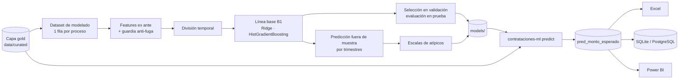

# 11. Machine learning: modelo de monto esperado

Fase 2 del proyecto. Un modelo de regresión estima **cuánto debería costar razonablemente un
proceso** según su perfil al convocarse y marca como **atípicos** los procesos cuyo monto
adjudicado se aleja mucho de lo esperado (sobrecosto o subcosto inusual).

No es un detector de fraude y no usa etiquetas manuales: el monto adjudicado ya es un valor
medible y objetivo. Lo que sí se cuida es que ninguna variable contenga, directa o
indirectamente, el resultado que se quiere predecir.

> **Uso responsable.** Un monto atípico **no** prueba una irregularidad ni atribuye
> responsabilidades. Señala un proceso que conviene revisar: puede ser una adjudicación parcial,
> un error de registro o un precio realmente inusual. Verifica cada caso en la fuente oficial.

**Estado:** el código, las pruebas, las salidas y la documentación están completos y validados
con los datos sintéticos. Falta la auditoría con datos reales (Fase 0) y el entrenamiento con
datos reales (ver [sección 10](#10-pendiente-fase-0-y-entrenamiento-con-datos-reales)).

## Inicio rápido

```bash
pip install -e ".[dev,ml]"          # el extra "ml" agrega scikit-learn
contrataciones run --source sample  # capa gold (data/curated)
contrataciones-ml train             # entrena, evalúa y registra el modelo
contrataciones-ml predict           # monto esperado y montos atípicos
contrataciones-ml list              # modelos registrados
```

También con `make train` / `make predict` o `python scripts/train.py` / `python scripts/predict.py`.

| Salida | Ubicación |
| --- | --- |
| Modelo (con su preprocesamiento) | `models/trained/<versión>.joblib` |
| Catálogo de modelos | `models/metadata/model_catalog.yaml` |
| Bitácora del experimento | `models/logs/experimento_<versión>.json` |
| Dataset de modelado | `data/features/dataset_modelado.parquet` |
| Predicciones | `data/predictions/pred_monto_esperado.parquet` y `.csv` |
| Reporte Excel | `data/exports/reporte_montos_atipicos.xlsx` |
| Base de datos | tabla `pred_monto_esperado` y vista `vw_montos_atipicos` |

## Flujo



Código: `src/contrataciones/features/` (catálogo, dataset, transformaciones, auditoría) y
`src/contrataciones/models/` (entrenamiento, evaluación, atípicos, registro, predicción,
reporte, orquestación y CLI). El pipeline de analítica no se modifica: el modelo lee la capa
gold ya generada y no recalcula nada de `processing/`.

---

## 1. Fuga de datos: qué se sabe al convocar

Una feature es válida solo si se conoce **al publicar la convocatoria**. Usar información que en
la práctica solo existe después de adjudicar haría que el modelo "hiciera trampa": métricas
excelentes en el papel e inútiles en la realidad.

### Evidencia de la publicación real (Fase 0 preliminar)

Revisión manual de 60 procesos reales convocados en 2026-09 (API del OECE) y de la historia de
versiones de los adjudicados, el 2026-10-20:

| Hallazgo | Evidencia | Consecuencia |
| --- | --- | --- |
| **Los postores se publican con el resultado** | En las versiones previas a la buena pro no hay `tenderers` ni `numberOfTenderers`; aparecen en la versión de la buena pro. Los 26 procesos con postores son 23 adjudicados y 3 desiertos | `n_postores` prohibida |
| **El valor referencial puede revelarse con la buena pro** | `hasTenderInformationProtectedByLaw` marca 31 procesos en selección (ninguno adjudicado); los 23 adjudicados figuran sin protección. De 7 adjudicados con historia verificable, 3 tenían valor 0 antes de la buena pro y en 2 el valor revelado es igual al adjudicado | `log_valor_referencial` es **condicional** |
| Adjudicado = referencial al céntimo | 15 de 23 adjudicados | Se reporta por segmento y en cada predicción |
| La capa gold guarda la última versión | `clean_procesos` conserva la versión más reciente de cada proceso | No se puede saber, fila por fila, qué era público al convocar |
| Plazo de presentación vacío | 100 % (`tenderPeriod` con inicio = fin) | `plazo_presentacion_dias` deshabilitada |

Es un indicio fuerte, no una conclusión (un mes, 60 procesos). La Fase 0 lo mide con datos
reales completos ([sección 10](#10-pendiente-fase-0-y-entrenamiento-con-datos-reales)).

### Guardia en el código

`src/contrataciones/features/catalog.py` valida cada feature declarada en
`config/model_config.yaml` y rechaza con `LeakageError`:

1. `available_at` distinto de `convocatoria`.
2. Columnas de tablas que describen el resultado: `fact_adjudicacion`, `fact_contrato`,
   `fact_postor`, `fact_alerta`, `fact_sancion`, `dim_proveedor`, `dim_indicador`,
   `agg_entidad_anio` y `dim_fecha` (se une por varias fechas; el mes se deriva de
   `fact_proceso.fecha_convocatoria_key`).
3. Columnas de `fact_proceso` que son el objetivo, posteriores o identificadores:
   `monto_adjudicado_pen`, `ratio_adjudicado_referencial`, `n_postores`, `n_adjudicaciones`,
   `estado`, `n_alertas`, `puntaje_riesgo`, `nivel_riesgo`, `nivel_riesgo_orden`, `ocid`,
   `proceso_key`, `nomenclatura`.
4. Cualquier columna cuyo nombre contenga `adjudic`, `postor`, `alerta`, `riesgo`, `ganador`,
   `sancion`, `proveedor` o `contrato` (defensa ante columnas que se agreguen en el futuro).
5. Tablas que no estén entre las permitidas: `fact_proceso`, `dim_metodo`, `dim_categoria`,
   `dim_entidad`.

Las listas viven en el código **a propósito**: no se pueden desactivar desde el YAML. Además, el
dataset de modelado ni siquiera copia las columnas prohibidas, y un modelo guardado vuelve a
validar sus features al cargarse.

### Canario de fuga

La guardia no puede detectar una columna con fuga que tenga un nombre inocente. Por eso las
pruebas incluyen un **canario**: si el objetivo es ruido puro, ningún modelo debe superar a la
mediana global; y si se agrega a propósito una columna derivada del objetivo, el canario se
dispara (`tests/test_models/test_trainer.py`).

## 2. Features

**Aceptadas** (declaradas en `config/model_config.yaml`):

| Feature | Origen en la capa gold | Por qué es válida | Transformación |
| --- | --- | --- | --- |
| `log_valor_referencial` | `fact_proceso.valor_referencial_pen` | Estimación de la entidad fijada antes de convocar. **Condicional** (sección 1) | `log1p` |
| `metodo` | `dim_metodo.metodo_detalle` | Se fija en la convocatoria; distingue también el régimen (Ley 30225 / Ley 32069) | Categórica |
| `es_competitivo` | `dim_metodo.es_competitivo` | Se deriva del método | Binaria |
| `categoria` | `dim_categoria.categoria` | Objeto de la convocatoria | Categórica |
| `entidad` | `dim_entidad.entidad_id` | La compradora se conoce al convocar | `TargetEncoder` ajustado solo con el entrenamiento |
| `tipo_entidad` | `dim_entidad.nombre` | Atributo fijo; ayuda con entidades que el modelo no vio | Reglas de palabras clave (`entity_types`) |
| `departamento` | `dim_entidad.departamento` | Atributo fijo de la entidad | Categórica |
| `mes_convocatoria` | `fact_proceso.fecha_convocatoria_key` | Sale de `tender.datePublished` | Mes `01`-`12` (estacionalidad) |
| `plazo_consultas_dias` | `fact_proceso.plazo_consultas_dias` | Parte del cronograma publicado | Numérica; los nulos los maneja el modelo |

El **año** se usa para dividir los datos, no como feature: al modelar una razón la inflación se
cancela, y en una división temporal el año de prueba nunca se vio al entrenar.

**Descartadas:**

| Columna | Motivo |
| --- | --- |
| `fact_proceso.n_postores` | Se publica con el resultado. Además es consecuencia del proceso: el modelo "explicaría" el sobreprecio por poca competencia, que es lo que se quiere detectar. RF01 ya cubre ese ángulo |
| `monto_adjudicado_pen`, `ratio_adjudicado_referencial` | Son el objetivo |
| `n_alertas`, `puntaje_riesgo`, `nivel_riesgo*` | Fuga indirecta: RF03 y RF04 usan el monto adjudicado y RF01 los postores |
| `n_adjudicaciones`, `estado` | Posteriores; `estado` además viene vacío en el OECE |
| `plazo_presentacion_dias` | Se conoce al convocar, pero viene vacío en la publicación real |
| `nomenclatura`, `ocid`, `proceso_key` | Identificadores: el modelo los memorizaría |
| `descripcion` | Válida, pero es texto libre: candidata para una versión posterior |
| Adjudicaciones, contratos, postores, proveedores, sanciones, alertas | Describen el resultado |
| `agg_entidad_anio` | Resume el año completo, incluidos el propio proceso y los posteriores. El historial de la entidad lo aporta el `TargetEncoder`, que solo ve el pasado |

**Candidatas futuras** (requieren cambios en `processing/`): la clasificación CUBSO de
`tender.items[]` (el mejor predictor posible de la estructura de precios) y la descripción como
texto.

## 3. Objetivo y población

**Unidad:** un proceso. **Objetivo:** `fact_proceso.monto_adjudicado_pen`, que el pipeline ya
calcula como la suma de las adjudicaciones válidas (no se recalcula).

El modelo aprende `y = log(monto adjudicado / valor referencial)` y el monto esperado es
`valor referencial x exp(predicción)`. Sigue prediciendo el monto adjudicado, pero:

* el error en escala log es el mismo para la razón y para el monto
  (`log(monto) = log(referencial) + log(razón)`), así que no se pierde nada;
* un modelo de árboles aproximaría `log(monto) ≈ log(referencial)` como una escalera, con
  errores de algunos puntos porcentuales, del orden de la señal que se busca;
* el modelo se concentra en lo incierto (el descuento o el sobreprecio) y el R² es honesto.

**Población:** procesos con fecha de convocatoria, adjudicación válida (monto > 0) y valor
referencial > 0, sin métodos ni categorías excluidos.

| Motivo de exclusión | ¿Se evalúa? | ¿Entrena? |
| --- | --- | --- |
| Sin fecha de convocatoria / sin adjudicación válida / sin valor referencial | No | No |
| Método o categoría excluidos (`population.exclude_*`) | No | No |
| Razón fuera de `[min_ratio, max_ratio]` (por defecto `[0.05, 5]`) | Sí, como *Revisar datos* | No |

Límites conocidos:

* **Adjudicación parcial:** si solo se adjudican algunos ítems, la suma adjudicada es menor que
  el referencial del proceso y aparece como subcosto. En la muestra real el 95 % de los procesos
  tiene un solo ítem.
* **Valor referencial inflado:** el modelo mide la desviación respecto de lo esperado *dado el
  referencial*; no detecta un referencial inflado, porque es su insumo principal.

## 4. División temporal

Por fecha de convocatoria, con cortes el primer día de un mes y una fecha de referencia (por
defecto, la adjudicación más reciente de los datos):

| Partición | Regla |
| --- | --- |
| `entrenamiento` | Convocado **y adjudicado** antes del inicio de la validación |
| `no_disponible` | Convocado antes de la validación pero adjudicado después: su monto no se conocía a esa fecha |
| `validacion` | Convocado en los `validation_months` anteriores a la prueba: elige el candidato |
| `prueba` | Convocado en los `test_months` anteriores al corte de madurez: se usa una sola vez |
| `no_evaluado` | Convocado en los últimos `maturity_months`: solo están adjudicados los procesos rápidos |
| `no_entrenable` | Fuera de la población o con razón fuera de rango |

En la muestra sintética: referencia 2026-01-18, validación desde 2025-04-01, prueba desde
2025-07-01 y corte de madurez el 2025-10-01 (656 / 114 / 138 procesos en entrenamiento,
validación y prueba).

Se descarta la división aleatoria: mezcla el futuro con el pasado, deja procesos casi gemelos de
la misma entidad a ambos lados y oculta el cambio de régimen de 2025.

**Predicción fuera de muestra.** Para el reporte histórico, cada proceso se predice con un modelo
entrenado sin su bloque (trimestre de convocatoria, `out_of_fold_block`). Si se puntuara con el
modelo que lo vio, los residuos del histórico serían artificialmente pequeños y aparecería un
aumento falso de atípicos en el periodo reciente. Los procesos nuevos (no vistos al entrenar) se
puntúan con el modelo final, entrenado con todos los procesos entrenables.

## 5. Modelos y métricas

| Modelo | Qué es |
| --- | --- |
| `razon_1` | Supone adjudicado = referencial (solo como referencia) |
| `mediana_global` | La misma razón para todos (referencia del canario) |
| `linea_base` (B1) | Mediana de la razón del entrenamiento por método y categoría; grupos con menos de `min_group_size` usan la mediana global |
| `ridge` | Lineal con imputación, *one-hot* (categorías infrecuentes agrupadas) y `TargetEncoder` para la entidad |
| `hist_gradient_boosting` | Árboles con pérdida absoluta (mediana condicional, robusta a montos extremos); maneja nulos y categorías de forma nativa |

Todas las transformaciones que aprenden de los datos van dentro de un `Pipeline` de
scikit-learn y se ajustan solo con el entrenamiento. El candidato se elige con
`selection_metric` (por defecto `mae_log`) en validación.

| Métrica | Lectura |
| --- | --- |
| `mae_log`, `rmse_log` | Principales. `exp(mae_log) - 1` es el error relativo típico |
| `r2_log_ratio` | R² honesto: qué parte de la variación del descuento se explica |
| `r2_log_monto` | Sale cercano a 1 solo porque el referencial explica la escala; no sirve para juzgar el modelo |
| `mdape`, `wape` | Lectura en soles; el WAPE pondera por gasto |
| **Mejora frente a B1** | `1 - mae_modelo / mae_linea_base` en prueba. **Criterio de aceptación:** al menos `min_improvement_vs_baseline` (10 %) |

Además se informan las métricas por categoría, método, quintil de valor referencial, trimestre y
"adjudicado = referencial", y la importancia de cada variable por permutación.

**Resultado con los datos sintéticos (esperado):** en la muestra, la razón adjudicado/referencial
es aleatoria e independiente de todas las variables, así que no hay nada que aprender. En prueba,
el candidato elegido (Ridge) obtiene un MAE log de 0.0834 frente a 0.0797 de la línea base
(mejora −4.7 %): **no aceptado**. `r2_log_monto` ≈ 0.996 mientras `r2_log_ratio` ≈ 0, que ilustra
por qué el primero es engañoso. Si con estos datos el modelo superara a la línea base, habría
una fuga.

## 6. Montos atípicos

`src/contrataciones/models/anomaly.py`:

1. `residuo = log(monto real) - log(monto esperado)`, con la predicción fuera de muestra.
2. Por segmento (`segment_by`, por defecto la categoría): `centro = mediana` y
   `escala = máx(1.4826 x MAD, min_scale)`. Los segmentos con menos de `min_segment_size`
   residuos usan la escala global. El piso es necesario porque la razón exacta 1.0 es tan
   frecuente en algunos segmentos (convenios, obras) que la MAD puede ser casi 0.
3. `z = (residuo - centro) / escala`.

| Tipo de desviación | Regla |
| --- | --- |
| Revisar datos | Razón fuera de `[min_ratio, max_ratio]` |
| Sobrecosto inusual | `z >= z_threshold` y `desviación >= min_deviation` (3 y +15 %) |
| Subcosto inusual | `z <= -z_threshold` y `desviación <= -min_deviation` |
| Normal | El resto |

El rango esperado es `esperado x exp(centro ± z_threshold x escala)`: un sobrecosto inusual
siempre queda por encima del máximo esperado. En la muestra sintética no hay atípicos: la razón
está acotada entre 0.75 y 1.10, así que ningún proceso se aleja lo suficiente. Las pruebas usan
datos con anomalías plantadas.

## 7. Salidas

### Tabla `pred_monto_esperado`

Una fila por proceso de la población. Se guarda en `data/predictions` (Parquet y CSV), en la base
de datos (DDL en `sql/ddl_ml/`) y alimenta el Excel y la página 7 de Power BI.

| Columna | Descripción |
| --- | --- |
| `proceso_key`, `ocid` | Proceso (`proceso_key` es de la misma corrida de la capa gold; `ocid` es estable) |
| `valor_referencial_pen`, `monto_adjudicado_pen` | Montos de la capa gold |
| `ratio_adjudicado_referencial` | Razón real |
| `ratio_esperado` | Razón esperada, `exp(predicción)` |
| `monto_esperado_pen` | `valor referencial x razón esperada` |
| `monto_minimo_esperado_pen`, `monto_maximo_esperado_pen` | Rango esperado (umbral de z) |
| `pct_desviacion` | `monto real / monto esperado - 1` (fracción) |
| `residuo_log`, `z_robusto` | Desviación en escala log y en unidades de la escala robusta |
| `tipo_desviacion`, `es_atipico` | Clasificación (sección 6); `es_atipico` excluye *Revisar datos* |
| `es_adjudicado_igual_referencial` | Diagnóstico del hallazgo de la sección 1 |
| `segmento_escala` | Segmento cuya escala se usó (`Global` si tenía pocos casos) |
| `origen_prediccion` | `Histórico (fuera de muestra)` o `Nuevo (modelo final)` |
| `modelo_version`, `modelo_aceptado`, `fecha_prediccion` | Trazabilidad |

### Otras salidas

* `data/features/dataset_modelado.parquet`: columnas de control (fechas, montos, objetivo,
  población, motivo de exclusión), partición, bloque, predicción fuera de muestra y features.
* `models/`: artefacto joblib (modelo final, features, configuración, escalas y predicciones fuera
  de muestra), catálogo YAML y bitácora JSON con métricas por segmento. Los artefactos se
  serializan con pickle: carga solo modelos generados por este proyecto.
* `data/exports/reporte_montos_atipicos.xlsx`: resumen, atípicos con su contexto, conteos por
  categoría, métricas, importancia y notas de uso responsable.
* Base de datos: tabla `pred_monto_esperado` **sin llaves foráneas** hacia la capa gold (el
  pipeline recarga `fact_proceso` con `DELETE` y SQLite valida las llaves foráneas), vista
  `vw_montos_atipicos` (atípicos con contexto y alertas por reglas) y la consulta
  `sql/queries_ml/01_atipicos_por_entidad.sql` (`contrataciones query ... --param minimo=5`).
  La vista solo se crea si la base ya tiene la capa gold.
* Power BI: `powerbi/power_query/03_predicciones_ml.pq`, relación 14 del modelo, medidas de la
  carpeta *08 Monto esperado (ML)* y página 7 de la especificación.

Después de cada `contrataciones run`, vuelve a ejecutar `contrataciones-ml predict`:
`proceso_key` cambia en cada corrida del pipeline.

## 8. ¿Por qué un reporte aparte y no un indicador RF08?

1. **Técnico.** El catálogo de indicadores y el despacho de `compute_flags` están fijos en
   `processing/risk_indicators.py`, y `score_processes` solo pondera esos códigos: un RF08
   agregado solo en `risk_rules.yaml` tendría peso 0. Además, el puntaje se calcula dentro de
   `build_gold` y el modelo lee la capa gold: es circular. Integrarlo exige modificar
   `risk_indicators.py` (aceptar alertas externas) y `pipeline.py` (leer las predicciones).
2. **Metodológico.** RF01-RF07 son reglas deterministas; una señal de ML cambia con cada
   reentrenamiento y el puntaje de un proceso cambiaría sin que cambien sus datos.
3. **Solapamiento.** RF03 (adjudicado ≥ 98 % del referencial) y RF04 (supera el referencial) ya
   capturan parte del sobrecosto: sumar RF08 contaría dos veces.

Se promoverá a RF08 cuando (a) la Fase 0 resuelva lo del valor referencial, (b) el modelo supere
a la línea base con datos reales fuera de muestra y (c) una revisión manual de los casos más
marcados sea razonable. Ese cambio a los dos módulos se presentará antes de hacerlo.

## 9. Configuración (`config/model_config.yaml`)

| Clave | Por defecto | Qué controla |
| --- | --- | --- |
| `population.min_ratio`, `max_ratio` | 0.05, 5.0 | Rango plausible de la razón adjudicado/referencial |
| `population.exclude_methods`, `exclude_categories` | `[]` | Exclusiones decididas en la Fase 0 |
| `features.<nombre>` | 9 habilitadas | `source`, `available_at`, `kind`, `transform`, `conditional`, `enabled`, `description` |
| `entity_types.rules` | 7 tipos | Palabras clave del tipo de entidad (gana la primera regla) |
| `split.reference_date` | `null` | Fecha de los datos (`null` = última adjudicación) |
| `split.maturity_months`, `test_months`, `validation_months` | 3, 3, 3 | Ventanas de la división temporal |
| `split.out_of_fold_block` | `quarter` | Bloques de la predicción fuera de muestra (`quarter` o `month`) |
| `models.candidates`, `selection_metric` | Ridge e HGB, `mae_log` | Candidatos y métrica de selección |
| `models.baseline` | método x categoría, 20 | Grupos y tamaño mínimo de la línea base |
| `models.ridge`, `models.hist_gradient_boosting` | ver YAML | Hiperparámetros |
| `models.min_improvement_vs_baseline` | 0.10 | Criterio de aceptación |
| `anomalies.*` | categoría, 30, 0.05, 3.0, 0.15 | Segmento, tamaño mínimo, piso de escala, umbral de z y desviación mínima |
| `output.*` | `pred_monto_esperado` | Nombre de la tabla, formatos, carga a la BD y reporte Excel |

## 10. Pendiente: Fase 0 y entrenamiento con datos reales

1. Datos reales: `contrataciones download --year 2024-2025` y
   `contrataciones run --source bulk --year 2025` (y 2024).
2. Páginas crudas recientes: `contrataciones run --source api --month AAAA-MM`.
3. Ejecuta `notebooks/ml/01_auditoria_fuga_de_datos.ipynb` con `CONSULTAR_API = True` (unas 200
   consultas a la API) y registra la decisión en `population.exclude_methods` /
   `exclude_categories`.
4. `contrataciones-ml train` y revisa `notebooks/ml/03_modelos_y_baselines.ipynb` (aceptación,
   segmentos, importancia).
5. `contrataciones-ml predict`, `notebooks/ml/04_evaluacion_y_atipicos.ipynb` y una revisión
   manual de los casos más marcados.

Con un año de datos reales cabe esperar decenas de miles de procesos: el entrenamiento ajusta un
modelo por trimestre para la predicción fuera de muestra, así que tarda minutos, no segundos.

## 11. Pruebas

`tests/test_features/` y `tests/test_models/` (sin internet; la API se simula con `responses`):

* **Guardia:** toda columna o tabla prohibida lanza `LeakageError`, aunque esté deshabilitada o
  se declare como conocida en la convocatoria; los modelos guardados se revalidan.
* **Canario:** con ruido puro el modelo no supera a la mediana global; con una columna derivada
  del objetivo, sí (prueba que el canario detecta fugas).
* **Señal plantada:** con una estructura que la línea base no capta, el modelo la supera y se
  acepta.
* **División:** nada del entrenamiento se convocó ni se adjudicó después del inicio de la
  validación; la madurez se respeta.
* **Fuera de muestra:** un estimador espía comprueba que ningún bloque se predice con un modelo
  que lo vio.
* **Atípicos:** piso de escala, segmentos pequeños, desviación mínima, errores de datos y
  coherencia entre el rango esperado y z.
* **Punta a punta:** pipeline → `train` → `predict` → base de datos, vista y consulta; y el
  pipeline de analítica sigue funcionando con la tabla de ML en la misma base.

## 12. Extender

**Agregar una feature:**

1. Declárala en `features` de `config/model_config.yaml` con su `source` (tabla.columna de la
   capa gold) y `available_at: convocatoria`. La guardia la rechazará si usa información del
   resultado.
2. Si necesita una transformación nueva, agrégala en `features/builder.py` y en `TRANSFORMS`
   (`features/catalog.py`), con su prueba.
3. Si viene de una tabla que no está en `ALLOWED_TABLES`, justifica en la revisión por qué se
   conoce al convocar y agrega una prueba en `tests/test_features/test_catalog.py`.
4. `contrataciones-ml train`: compara la mejora frente a la línea base y la importancia.

**Agregar un modelo candidato:** créalo en `make_estimator` (`models/trainer.py`) como un
`Pipeline` que ajuste toda transformación con el entrenamiento, agrégalo a `models.candidates` y
cubre el caso en `tests/test_models/test_trainer.py`.
