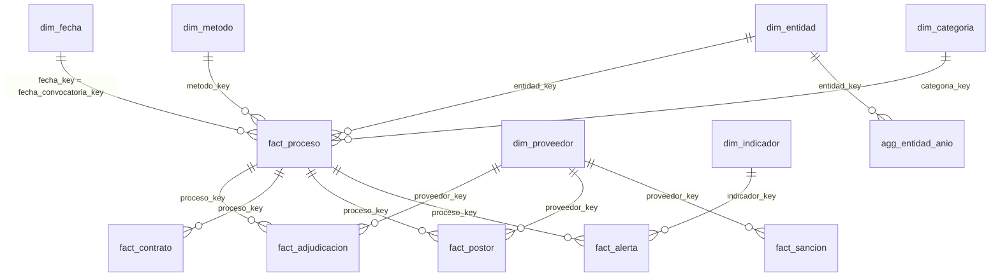

# Modelo de datos en Power BI

El modelo es un **esquema estrella** con un patrón **cabecera-detalle**: `fact_proceso` es la
tabla de hechos principal (un registro por proceso) y las tablas `fact_adjudicacion`,
`fact_contrato`, `fact_postor` y `fact_alerta` son su detalle.



## Relaciones a crear

`Model view > Manage relationships > New`. Todas son **Many to one (*:1)**, con
**Cross filter direction: Single** y **activas**.

| # | Desde (lado muchos) | Hacia (lado uno) | Para qué sirve |
| --- | --- | --- | --- |
| 1 | `fact_proceso[fecha_convocatoria_key]` | `dim_fecha[fecha_key]` | Análisis por fecha de convocatoria |
| 2 | `fact_proceso[entidad_key]` | `dim_entidad[entidad_key]` | Quién compra |
| 3 | `fact_proceso[metodo_key]` | `dim_metodo[metodo_key]` | Tipo de procedimiento |
| 4 | `fact_proceso[categoria_key]` | `dim_categoria[categoria_key]` | Bienes, servicios, obras |
| 5 | `fact_adjudicacion[proceso_key]` | `fact_proceso[proceso_key]` | Detalle de adjudicaciones |
| 6 | `fact_adjudicacion[proveedor_key]` | `dim_proveedor[proveedor_key]` | Quién vende |
| 7 | `fact_contrato[proceso_key]` | `fact_proceso[proceso_key]` | Detalle de contratos |
| 8 | `fact_postor[proceso_key]` | `fact_proceso[proceso_key]` | Participación |
| 9 | `fact_postor[proveedor_key]` | `dim_proveedor[proveedor_key]` | Participación por proveedor |
| 10 | `fact_alerta[proceso_key]` | `fact_proceso[proceso_key]` | Alertas por proceso |
| 11 | `fact_alerta[indicador_key]` | `dim_indicador[indicador_key]` | Alertas por indicador |
| 12 | `fact_sancion[proveedor_key]` | `dim_proveedor[proveedor_key]` | Sanciones por proveedor |
| 13 | `agg_entidad_anio[entidad_key]` | `dim_entidad[entidad_key]` | KPIs por entidad y año |

> Power BI puede detectar algunas relaciones automáticamente (`Autodetect`). Revisa que coincidan
> con esta tabla y elimina cualquier relación adicional.

### Por qué así

* **Sin relaciones directas** de `fact_adjudicacion` o `fact_contrato` con `dim_fecha` ni con
  `dim_entidad`: esos filtros ya llegan a través de `fact_proceso`. Una segunda ruta crearía
  ambigüedad y Power BI desactivaría relaciones.
* Para analizar por **fecha de adjudicación** usa una dimensión de fecha de rol (*role-playing*):
  `Modeling > New table`:

  ```dax
  dim_fecha_adjudicacion = dim_fecha
  ```

  y relaciona `fact_adjudicacion[fecha_adjudicacion_key]` con `dim_fecha_adjudicacion[fecha_key]`.
* `agg_entidad_anio` tiene grano entidad-año, por eso el año se aplica en las medidas con
  `TREATAS` (ver `measures/medidas_dax.md`).

## Configuración de columnas

| Tabla | Columna | Ajuste en Power BI |
| --- | --- | --- |
| `dim_fecha` | — | `Table tools > Mark as date table` → columna `fecha` |
| `dim_fecha` | `nombre_mes` | `Column tools > Sort by column` → `mes` |
| `dim_fecha` | `nombre_dia` | `Sort by column` → `dia_semana` |
| `fact_proceso` | `nivel_riesgo` | `Sort by column` → `nivel_riesgo_orden` |
| `dim_entidad` | `departamento` | `Column tools > Data category` → `State or Province` |
| `dim_entidad` | `pais` | `Data category` → `Country` |
| Todas | columnas `*_key` | `Properties > Is hidden` = Sí (se usan solo para relaciones) |
| `fact_*` | columnas numéricas | `Summarization` = `Don't summarize`; usa medidas DAX |

## Diccionario resumido

El diccionario completo está en `docs/06_modelo_de_datos.md`. Columnas más usadas:

| Tabla | Columnas clave para el análisis |
| --- | --- |
| `fact_proceso` | `valor_referencial_pen`, `monto_adjudicado_pen`, `n_postores`, `plazo_presentacion_dias`, `plazo_consultas_dias`, `puntaje_riesgo`, `nivel_riesgo` |
| `fact_adjudicacion` | `monto_asignado_pen` (prorrateado entre consorciados), `es_valida`, `proveedor_inhabilitado` |
| `dim_entidad` | `nombre`, `ruc`, `departamento` |
| `dim_proveedor` | `nombre`, `ruc` (vacío en consorcios), `tipo_persona` (incluye Consorcio), `tiene_sancion` |
| `dim_metodo` | `metodo_detalle` (procedimiento), `es_competitivo` |
| `dim_indicador` | `codigo`, `nombre`, `peso` |
| `agg_entidad_anio` | `pct_postor_unico`, `hhi`, `n_proveedores` |
